  

 
<table align="center">
<tr><td><b><a href="https://github.com/mdoin/oohplayer">oohplayer</a></b></td><td>Reverse-engineered a vendor's APK, rewrote the player, patched the firmware. Fleet of Android set-top boxes, zero manual setup.</td></tr>
<tr><td><b><a href="https://github.com/mdoin/crmsaas">crmsaas</a></b></td><td>Extracted a CRM from a monolith into a multi-tenant SaaS. One schema per account, not one WHERE clause per query.</td></tr>
<tr><td><b><a href="https://github.com/mdoin/manutencaooh">manutencaooh</a></b></td><td>Monitors a display network, infers operating hours from behavior, correlates incidents by cause.</td></tr>
<tr><td><b><a href="https://github.com/mdoin/leadcapturer">leadcapturer</a></b></td><td>B2B lead pipeline from natural language to scored spreadsheet. Deterministic first, LLM as optional layer.</td></tr>
<tr><td><b><a href="https://github.com/mdoin/interativooh">interativooh</a></b></td><td>Generates an ad from a mobile form, moderates it with AI, puts it on an LED panel in minutes.</td></tr>
<tr><td><b><a href="https://github.com/mdoin/contadorooh">contadorooh</a></b></td><td>Counts vehicles with CV. Four mechanisms against double-counting. Promotes nothing to "bus" because erring high destroys the metric.</td></tr>
<tr><td><b><a href="https://github.com/mdoin/copilotofinanceiro">copilotofinanceiro</a></b></td><td>Finance automation where AI suggests and code decides. 13-state machine with independent verification.</td></tr>
<tr><td><b><a href="https://github.com/mdoin/catalogodooh">catalogodooh</a></b></td><td>OOH sales platform with photorealistic simulation. The engine samples light from the photo instead of inventing it.</td></tr>
</table>
 

<b>things I reach for</b>

 
| | |
|---|---|
| **languages** | TypeScript · Python · Java · Kotlin · SQL |
| **backend** | Node.js · Express · Fastify · FastAPI |
| **frontend** | React · Next.js · React Native · Vite · Tailwind |
| **data** | PostgreSQL · SQLite · Sequelize · SQLAlchemy |
| **cv & ml** | YOLO · ByteTrack · OpenCV · InsightFace · OpenCLIP · PyTorch |
| **ai** | Gemini · OpenAI API · structured output · grounding |
| **infra** | Docker · nginx · Caddy · PM2 · ADB · systemd |
| **embedded** | Android SDK · ExoPlayer · AOSP · ext4 · firmware tooling |
| **quality** | Zod · Vitest · Playwright · WebAuthn · AES-256-GCM |
 

 

  <picture>
    <source media="(prefers-color-scheme: dark)" srcset="https://github-readme-stats.vercel.app/api?username=mdoin&show_icons=true&theme=github_dark&hide_border=true&count_private=true&include_all_commits=true&icon_color=e8558f&title_color=e8558f" />
    
  </picture>
  <picture>
    <source media="(prefers-color-scheme: dark)" srcset="https://github-readme-stats.vercel.app/api/top-langs/?username=mdoin&layout=compact&theme=github_dark&hide_border=true&langs_count=8&title_color=e8558f" />
    
  </picture>

  <picture>
    <source media="(prefers-color-scheme: dark)" srcset="https://github-readme-streak-stats.herokuapp.com/?user=mdoin&theme=github-dark-blue&hide_border=true&ring=e8558f&fire=ff7ab6&currStreakLabel=e8558f" />
    
  </picture>

 

  <a href="https://linkedin.com/in/maitedoin">linkedin</a> · <a href="https://www.doinlabs.com.br">doinlabs.com.br</a>

